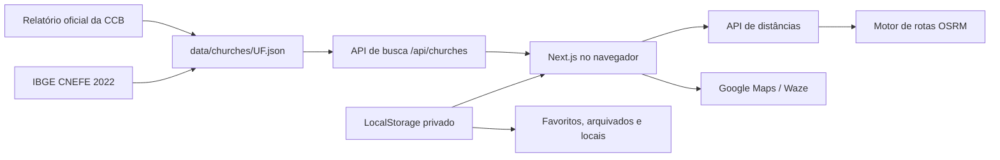

<div align="center">
  <h1>⛪ Localizador de Casas de Oração</h1>
  <h3>Todo o Brasil</h3>
  <p>Encontre a casa de oração mais próxima, por dia, período e distância.<br />Mais perto. Mais simples. Direto ao caminho.</p>
  <p><strong>Projeto independente, sem vínculo com a Congregação Cristã no Brasil.</strong></p>
  <p>
    <a href="package.json"></a>
    <a href="https://nextjs.org/"></a>
    <a href="https://react.dev/"></a>
    <a href="https://www.typescriptlang.org/"></a>
    <a href="https://vercel.com/"></a>
    <a href="LICENSE"></a>
  </p>
  <p>
    <a href="#-funcionalidades">Funcionalidades</a> •
    <a href="#-dados-e-manutenção">Dados</a> •
    <a href="#-instalação-local">Instalação</a> •
    <a href="#-deploy-na-vercel">Deploy</a> •
    <a href="#-instalar-como-aplicativo">Instalar</a> •
    <a href="#-independência-termos-e-apoio">Termos e apoio</a> •
    <a href="#-créditos">Créditos</a>
  </p>
</div>

---

## 📌 Sobre o projeto

> **Aviso de independência.** Este app não é um canal oficial e não foi criado, autorizado, patrocinado nem endossado pela Congregação Cristã no Brasil. O nome da instituição aparece somente para identificar de quais casas de oração o app trata; o app não usa o nome nem a marca dela. A fonte oficial é o [relatório público da instituição](https://congregacaocristanobrasil.org.br/relatorio).

Aplicação web instalável (PWA) para encontrar casas de oração da Congregação Cristã no Brasil em **todo o país**. A experiência elimina a navegação repetitiva do relatório nacional: o dia atual já vem selecionado, os filtros ficam salvos e, com a localização do aparelho, os resultados aparecem em ordem de distância, em qualquer estado.

O projeto funciona sem cadastro e sem banco de dados. A agenda pública fica versionada em JSON (um arquivo por estado); favoritos, arquivados, filtros e locais pessoais ficam somente no `localStorage` do navegador do usuário.

> **Cobertura atual:** 21.280 casas de oração em 27 estados, conferidas no relatório oficial em 20/11/2026. Posição no mapa: 10.362 confirmadas (com rota), 892 só aproximadas e 10.026 sem posição segura (sem rota; o app mostra o endereço oficial).

## ✨ Funcionalidades

| Área | Recursos disponíveis |
| --- | --- |
| 📍 **Localização** | GPS lido na hora (nunca do cache), validação de precisão e endereços pessoais persistentes; as casas mais próximas são buscadas no país todo |
| 🌎 **Região** | Sem localização, escolha o estado e a cidade (com a quantidade de casas de cada uma) |
| 🧭 **Distância** | Trajeto de carro até o ponto conferido de cada casa, da mais próxima para a mais distante; se o serviço de rotas cair, mostra estimativa em linha reta com aviso |
| 📅 **Agenda** | Filtro por dia da semana e seleção automática do dia atual; as casas mais próximas que não têm culto naquele dia aparecem em "Perto de você, em outros dias" |
| 🌅 **Período** | Manhã, tarde, noite ou todos, com identificação automática pelo horário |
| ⛪ **Serviços** | Culto oficial e Reunião de Jovens e Menores apresentados diretamente no card |
| 👥 **Detalhes** | Ministério, telefones e agenda completa exibidos ao abrir cada casa de oração |
| ⭐ **Favoritos** | Seleção privada e persistente, com área dedicada |
| 🗄️ **Arquivados** | Oculta casas das buscas, permite restaurar individualmente ou desarquivar todas |
| 🚗 **Rotas** | Waze e Google Maps abrem direto no ponto **somente quando a posição foi confirmada**. Sem confirmação não há rota: o app mostra o endereço oficial e um botão para copiá-lo |
| 🚩 **Correções** | Cada casa tem um link para avisar por e-mail que o endereço ou a posição está errado |
| 📱 **Aplicativo** | Instalável direto pelo navegador (PWA), com convite na primeira visita e abertura em tela cheia |
| 🔎 **Busca** | Pesquisa por casa, bairro, cidade ou endereço dentro da região |
| 🔐 **Privacidade** | Nenhuma conta, cookie de rastreamento ou dado pessoal enviado para um banco |

## 🧱 Decisão de arquitetura

Um banco de dados não é necessário para este escopo. Os dados públicos mudam pouco e são mantidos em [`data/churches/`](data/churches) (`<UF>.json` por estado e `index.json` com o resumo), enquanto preferências pessoais pertencem somente ao dispositivo. Como a base nacional é grande demais para ir inteira ao navegador, a busca roda no servidor (`/api/churches`), que lê só os estados vizinhos ao ponto de saída e devolve as casas mais próximas. Isso reduz custo, manutenção e superfície de segurança.



## 🗺️ Dados e manutenção

Os dados vêm do [relatório oficial da CCB](https://congregacaocristanobrasil.org.br/relatorio): o atualizador percorre todos os estados e cidades do relatório, lê o detalhe de cada casa e só então grava endereço, agenda, ministério e telefones.

```bash
npm run data:update                 # todos os estados (retomável; leva algumas horas)
npm run data:update -- --uf=DF,GO   # só alguns estados
npm run data:validate               # integridade da base
```

A posição de uma casa é preservada enquanto o endereço oficial não mudar; se mudar, ela é zerada até a próxima geocodificação. Antes de publicar, revise o diff e confirme mudanças relevantes no relatório oficial. Casas que o relatório lista sem nenhum horário (35 hoje) ficam registradas em `skipped` no arquivo do estado e não aparecem no app.

### Posição no mapa

O relatório oficial não traz coordenadas, e geocodificar o endereço por texto ou CEP erra por quilômetros. Por isso a posição vem do **CNEFE** (Cadastro Nacional de Endereços para Fins Estatísticos, IBGE, Censo 2022), que registra cada endereço com GPS coletado no local e o nome do estabelecimento:

```bash
npm run data:geocode                # todos os estados (baixa ~3,9 GB do IBGE em .cache/cnefe/)
npm run data:geocode -- --uf=DF     # só um estado
```

| `coordinateStatus` | Critério | Uso no app |
| --- | --- | --- |
| `verified` | O IBGE registrou um templo da Congregação no endereço do relatório oficial (mesmo CEP e, quando o endereço tem número, o mesmo número) | Distância de carro e rota direto no ponto (Waze e Google Maps) |
| `approximate` | Só o endereço (ou o CEP curto) foi localizado, sem templo registrado | Distância com “≈”, **sem rota** |
| `unavailable` | Nenhuma correspondência segura | Sem distância e **sem rota**; só o endereço oficial |

Regra de ouro: **na dúvida, a rota fica indisponível.** Duas casas no mesmo ponto, ou um número de imóvel que não confere, derrubam a posição. `npm run data:geocode -- --candidates` mostra os templos ainda não atribuídos mais parecidos com cada casa pendente. Casos conferidos à mão ficam em [`data/coordinate-overrides.json`](data/coordinate-overrides.json), sempre apontando o código do registro no CNEFE e o motivo — nunca uma coordenada digitada. Cada casa com posição guarda o `cnefeId` de origem, para auditoria.

Os links de rota são os oficiais do Waze (`waze.com/ul?ll=lat,lng`) e do Google Maps (`maps/dir/?api=1&destination=lat,lng`): levam exatamente à coordenada gravada. Nenhum dos dois oferece consulta automática gratuita (o Waze bloqueia robôs), então a conferência extra é por amostragem com o OpenStreetMap:

```bash
npm run data:audit -- --n=40 --uf=SP   # sorteia casas confirmadas e procura a CCB no OSM, a ~280 m
```

## 🛠️ Tecnologias

- **Next.js 16** com App Router.
- **React 19** e **TypeScript**.
- **Tailwind CSS 4** e CSS responsivo próprio.
- **Lucide React** para iconografia acessível.
- **LocalStorage** para preferências privadas.
- **OpenStreetMap Nominatim** para localizar endereços pessoais.
- **OSRM** para calcular distâncias rodoviárias sem chave de API, com servidor reserva.
- **IBGE CNEFE 2022** para a posição conferida de cada casa de oração.
- **PWA** (manifest + service worker) para instalar sem loja.
- **Vercel** como destino de produção.

## 🚀 Instalação local

```bash
git clone https://github.com/RDEsley/Relatorio-CCB-Brasilia.git
cd Relatorio-CCB-Brasilia
npm ci
npm run dev
```

Acesse [http://localhost:3000](http://localhost:3000).

### Comandos úteis

| Comando | Finalidade |
| --- | --- |
| `npm run dev` | Inicia o ambiente de desenvolvimento |
| `npm run build` | Gera o build otimizado |
| `npm run lint` | Verifica a qualidade do código |
| `npm run data:update` | Atualiza a agenda das casas de oração (todos os estados; `-- --uf=DF` limita) |
| `npm run data:geocode` | Reposiciona as casas pelo cadastro de endereços do IBGE |
| `npm run data:validate` | Valida escopo, fonte, códigos, coordenadas e rotas |
| `npm run data:audit` | Confere por amostragem as posições confirmadas contra o OpenStreetMap |
| `npm run data:icons` | Gera favicons, ícone maskable e imagem de pré-visualização a partir do SVG |

## ☁️ Deploy na Vercel

1. Importe este repositório na Vercel.
2. Mantenha o framework **Next.js** detectado automaticamente.
3. Não é necessário cadastrar variáveis de ambiente.
4. Publique o projeto.

O [`vercel.json`](vercel.json) já configura a região de São Paulo. Previews de pull requests também funcionam sem serviços externos.

## 📱 Instalar como aplicativo

O site é um PWA: o próprio navegador o instala, sem loja e sem baixar arquivo.

- **Android e computador (Chrome/Edge):** quem acessa vê o convite "Instale o app"; um toque em **Instalar** abre o diálogo do navegador.
- **iPhone (Safari):** Compartilhar → **Adicionar à Tela de Início**; o convite mostra esse passo a passo.
- "Agora não" adia o convite por 14 dias. O botão **Instalar app** (topo no celular, rodapé em qualquer tela) reabre a janela, e tudo some quando o app já está instalado.
- [`public/sw.js`](public/sw.js) busca sempre a rede primeiro, então o app instalado acompanha cada deploy; sem conexão, abre a última versão vista (as distâncias exigem internet).

## 🤲 Independência, termos e apoio

- **Nome e marca:** o app se chama *Localizador de Casas de Oração* e usa um ícone próprio. Nome, descrições e o aviso de independência ficam em [`lib/site.ts`](lib/site.ts); o aviso aparece no rodapé de todas as telas.
- **Termos de uso** em `/termos` e **Política de privacidade** em `/privacidade`, escritos a partir do que o app realmente faz com os dados (LGPD).
- **Apoio ao desenvolvedor** em `/apoiar`: doação voluntária por Pix, de qualquer valor. O código Pix e o QR Code só aparecem depois que a pessoa confirma ter lido que **a doação vai para o desenvolvedor, e não para a Congregação Cristã no Brasil**. Nenhuma função é bloqueada. Além do link no rodapé, há um cartão dispensável e um convite que aparece uma única vez, a partir da quinta visita; os dois repetem que a doação não é para a igreja. Quem copia o código recebe um agradecimento, e o app continua sem saber se alguém doou.
- O Pix é estático (BR Code gerado no navegador por [`lib/pix.ts`](lib/pix.ts)), sem intermediário e sem taxa. Por isso o app **não sabe se alguém doou nem quanto**: o total fica no extrato do recebedor, identificado por `CASASORACAO`. A configuração está em [`lib/donation.ts`](lib/donation.ts).

## 🔐 Privacidade e limites

- O site envia cabeçalhos de segurança (nosniff, anti-iframe, política de referrer).
- A origem é enviada ao servidor do app para listar as casas mais próximas e, daí, ao OSRM para calcular as distâncias; nada é armazenado.
- Endereços salvos são localizados pelo OpenStreetMap: resultados que contradizem o digitado (outra quadra) são recusados, e resultados só de bairro ou cidade geram um aviso de ponto de saída aproximado.
- A posição atual não fica salva entre visitas; somente endereços cadastrados manualmente permanecem no navegador.
- Ao cadastrar um endereço, a busca de coordenadas usa o serviço público Nominatim (inclua cidade e estado, pois a busca vale para o Brasil todo).
- Limpar os dados do navegador remove favoritos, arquivados e locais salvos.
- As posições vêm do Censo 2022: um templo que mudou de endereço depois disso perde a posição na próxima atualização, em vez de apontar para o lugar antigo.
- A distância de carro vem do OSRM, sem trânsito; o Waze pode indicar um trajeto um pouco diferente na hora.
- Agendas podem mudar por reformas, eventos ou decisões locais; confirme alterações no relatório oficial.
- Este é um projeto independente, sem vínculo com a Congregação Cristã no Brasil, e não a representa.

## 🤝 Contribuição

Contribuições são bem-vindas, especialmente correções de endereço e horário. Abra uma issue com a fonte da informação ou envie um pull request pequeno e objetivo.

## 📄 Licença

Distribuído sob a licença MIT. Consulte [`LICENSE`](LICENSE).

---

## 👨‍💻 Créditos

<div align="center">
  <a href="https://github.com/RDEsley">
    
  </a>
  <h3>Richard Oliveira</h3>
  <p><strong>Desenvolvimento e arquitetura de software</strong></p>
  <p>
    <a href="https://github.com/RDEsley"></a>
    <a href="mailto:richardesleyso@gmail.com"></a>
  </p>
</div>
