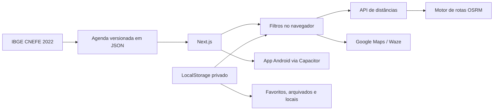

<div align="center">
  <h1>⛪ Casas de Oração</h1>
  <h3>Brasília & Águas Lindas</h3>
  <p>Encontre o próximo culto por dia, período e distância.<br />Mais perto. Mais simples. Direto ao caminho.</p>
  <p>
    <a href="package.json"></a>
    <a href="https://nextjs.org/"></a>
    <a href="https://react.dev/"></a>
    <a href="https://www.typescriptlang.org/"></a>
    <a href="https://vercel.com/"></a>
    <a href="LICENSE"></a>
  </p>
  <p>
    <a href="#-funcionalidades">Funcionalidades</a> •
    <a href="#-dados-e-manutenção">Dados</a> •
    <a href="#-instalação-local">Instalação</a> •
    <a href="#-deploy-na-vercel">Deploy</a> •
    <a href="#-aplicativo-android">App Android</a> •
    <a href="#-créditos">Créditos</a>
  </p>
</div>

---

## 📌 Sobre o projeto

Aplicação web e aplicativo Android focados nas casas de oração da Congregação Cristã no Brasil no **Distrito Federal** e em **Águas Lindas de Goiás**. A experiência elimina a navegação repetitiva do relatório nacional: o dia atual já vem selecionado, os filtros ficam salvos e os resultados aparecem em ordem de distância.

O projeto funciona sem cadastro e sem banco de dados. A agenda pública fica versionada em JSON; favoritos, arquivados, filtros e locais pessoais ficam somente no `localStorage` do navegador do usuário.

> **Cobertura atual:** 137 casas de oração e 461 horários de culto/RJM, conferidos em 26/08/2026. Posição no mapa: 114 confirmadas, 13 aproximadas e 10 sem posição segura.

## ✨ Funcionalidades

| Área | Recursos disponíveis |
| --- | --- |
| 📍 **Localização** | GPS lido na hora (nunca do cache), validação de precisão e endereços pessoais persistentes |
| 🧭 **Distância** | Trajeto de carro até o ponto conferido de cada casa, da mais próxima para a mais distante; se o serviço de rotas cair, mostra estimativa em linha reta com aviso |
| 📅 **Agenda** | Filtro por dia da semana e seleção automática do dia atual; as casas mais próximas que não têm culto naquele dia aparecem em "Perto de você, em outros dias", com atalho para o dia em que têm |
| 🌅 **Período** | Manhã, tarde, noite ou todos, com identificação automática pelo horário |
| ⛪ **Serviços** | Culto oficial e Reunião de Jovens e Menores apresentados diretamente no card |
| 👥 **Detalhes** | Ministério, telefones e agenda completa exibidos ao abrir cada casa de oração |
| ⭐ **Favoritos** | Seleção privada e persistente, com área dedicada |
| 🗄️ **Arquivados** | Oculta casas das buscas, permite restaurar individualmente ou desarquivar todas |
| 🚗 **Rotas** | Waze e Google Maps abrem direto no ponto quando a posição é confirmada; nas demais, pela busca do endereço oficial, com aviso para conferir o destino |
| 📱 **Aplicativo** | Mesmo código empacotado para Android com Capacitor, com GPS nativo e botão voltar |
| 🔎 **Busca** | Pesquisa instantânea por casa, bairro, cidade ou endereço |
| 🔐 **Privacidade** | Nenhuma conta, cookie de rastreamento ou dado pessoal enviado para um banco |

## 🧱 Decisão de arquitetura

Um banco de dados não é necessário para este escopo. Os dados públicos mudam pouco e são mantidos em [`data/churches.json`](data/churches.json), enquanto preferências pessoais pertencem somente ao dispositivo. Isso reduz custo, manutenção, superfície de segurança e dependência de serviços externos.



## 🗺️ Dados e manutenção

Os dados foram cruzados com o [Relatório oficial da CCB](https://congregacaocristanobrasil.org.br/relatorio) e páginas de consulta derivadas do Relatório Digital. O script de atualização cobre todas as 23 localidades cadastradas do DF, além de Águas Lindas de Goiás.

Para atualizar a base:

```bash
npm run data:update
```

O atualizador consulta cada código diretamente no relatório oficial, confere a correspondência e só então grava endereço, agenda, ministério e telefones. Para executar as verificações de integridade da base e dos links:

```bash
npm run data:validate
```

O comando atualiza [`data/churches.json`](data/churches.json). A posição de uma casa é preservada enquanto o endereço oficial não mudar; se mudar, ela é zerada até a próxima geocodificação. Antes de publicar, revise o diff do arquivo e confirme mudanças relevantes no relatório oficial.

### Posição no mapa

O relatório oficial não traz coordenadas, e geocodificar o endereço por texto ou CEP erra por quilômetros no DF e em Águas Lindas. Por isso a posição vem do **CNEFE** (Cadastro Nacional de Endereços para Fins Estatísticos, IBGE, Censo 2022), que registra cada endereço com GPS coletado no local e o nome do estabelecimento:

```bash
npm run data:geocode
```

| `coordinateStatus` | Critério | Uso no app |
| --- | --- | --- |
| `verified` | O IBGE registrou um templo da Congregação no endereço do relatório oficial | Distância de carro e rota direto no ponto |
| `approximate` | Só o endereço (ou o CEP curto) foi localizado, sem templo registrado | Distância com “≈” e rota pela busca do endereço |
| `unavailable` | Nenhuma correspondência segura | Sem distância; rota pela busca do endereço |

O script baixa os arquivos do IBGE para `.cache/cnefe/` (uns 22 MB), cruza CEP, numeração e nome, e lista o que ficou pendente. `npm run data:geocode -- --candidates` mostra os templos ainda não atribuídos mais parecidos com cada casa pendente. Casos conferidos à mão ficam em [`data/coordinate-overrides.json`](data/coordinate-overrides.json), sempre apontando o código do registro no CNEFE e o motivo — nunca uma coordenada digitada.

## 🛠️ Tecnologias

- **Next.js 16** com App Router.
- **React 19** e **TypeScript**.
- **Tailwind CSS 4** e CSS responsivo próprio.
- **Lucide React** para iconografia acessível.
- **LocalStorage** para preferências privadas.
- **OpenStreetMap Nominatim** para localizar endereços pessoais.
- **OSRM** para calcular distâncias rodoviárias sem chave de API, com servidor reserva.
- **IBGE CNEFE 2022** para a posição conferida de cada casa de oração.
- **Capacitor 8** para o aplicativo Android.
- **Vercel** como destino de produção.

## 🚀 Instalação local

```bash
git clone https://github.com/RDEsley/Relatorio-CCB-Brasilia.git
cd Relatorio-CCB-Brasilia
npm ci
npm run dev
```

Acesse [http://localhost:3000](http://localhost:3000).

### Comandos úteis

| Comando | Finalidade |
| --- | --- |
| `npm run dev` | Inicia o ambiente de desenvolvimento |
| `npm run build` | Gera o build otimizado |
| `npm run lint` | Verifica a qualidade do código |
| `npm run data:update` | Atualiza a agenda das casas de oração |
| `npm run data:geocode` | Reposiciona as casas pelo cadastro de endereços do IBGE |
| `npm run data:validate` | Valida escopo, fonte, códigos, coordenadas e rotas |
| `npm run build:mobile` | Gera o site estático e sincroniza o projeto Android |
| `npm run android:open` | Abre o projeto no Android Studio |

## ☁️ Deploy na Vercel

1. Importe este repositório na Vercel.
2. Mantenha o framework **Next.js** detectado automaticamente.
3. Não é necessário cadastrar variáveis de ambiente.
4. Publique o projeto.

O [`vercel.json`](vercel.json) já configura a região de São Paulo. Previews de pull requests também funcionam sem serviços externos.

## 📱 Aplicativo Android

O app é o mesmo site exportado como estático e embarcado com Capacitor. O cálculo de rotas continua na API publicada (`/api/distances`), então **publique o site antes de distribuir o app**.

```bash
npm run build:mobile   # next build (export) + cap sync android
npm run android:open   # abre android/ no Android Studio
```

Requisitos: Android Studio com SDK 36 e JDK 21 (o JBR do Android Studio serve). Para um APK de teste pela linha de comando: `cd android && ./gradlew assembleDebug` (saída em `android/app/build/outputs/apk/debug/`).

- **Convite no site:** quem abre o site no Android vê um banner para baixar o app. "Agora não" adia por 14 dias, e o botão "Baixar app" (topo no celular, rodapé em qualquer tela) reabre a janela. O link vem de `NEXT_PUBLIC_APP_DOWNLOAD_URL`; o padrão é o arquivo `casas-de-oracao.apk` na última release do GitHub — publique o APK lá com esse nome (ou configure a URL da Google Play).
- `NEXT_PUBLIC_API_BASE` troca o endereço da API usado pelo app (padrão: produção na Vercel).
- Ícone e splash: `node scripts/build-app-icon.mjs` e depois `npx capacitor-assets generate --android`.
- Para a Google Play: gere um bundle assinado em **Build → Generate Signed App Bundle**, informe a política de privacidade (`/privacidade`) e declare o uso de localização em primeiro plano. O `appId` (`io.github.rdesley.casasdeoracao`) não pode mudar depois da primeira publicação.

## 🔐 Privacidade e limites

- O site envia cabeçalhos de segurança (nosniff, anti-iframe, política de referrer) e o app Android não permite backup automático dos dados locais.
- A origem é enviada temporariamente ao endpoint de rotas e ao OSRM somente para calcular as distâncias; o servidor não a armazena.
- Endereços salvos são localizados pelo OpenStreetMap: resultados que contradizem o digitado (outra quadra) são recusados, e resultados só de bairro ou cidade geram um aviso de ponto de saída aproximado.
- A posição atual não fica salva entre visitas; somente endereços cadastrados manualmente permanecem no navegador.
- Ao cadastrar um endereço, a busca de coordenadas usa o serviço público Nominatim.
- Limpar os dados do navegador remove favoritos, arquivados e locais salvos.
- As posições vêm do Censo 2022: um templo que mudou de endereço depois disso perde a posição na próxima atualização, em vez de apontar para o lugar antigo.
- A distância de carro vem do OSRM, sem trânsito; o Waze pode indicar um trajeto um pouco diferente na hora.
- Agendas podem mudar por reformas, eventos ou decisões locais; confirme alterações no relatório oficial.
- Este é um projeto independente e não representa oficialmente a Congregação Cristã no Brasil.

## 🤝 Contribuição

Contribuições são bem-vindas, especialmente correções de endereço e horário. Abra uma issue com a fonte da informação ou envie um pull request pequeno e objetivo.

## 📄 Licença

Distribuído sob a licença MIT. Consulte [`LICENSE`](LICENSE).

---

## 👨‍💻 Créditos

<div align="center">
  <a href="https://github.com/RDEsley">
    
  </a>
  <h3>Richard Oliveira</h3>
  <p><strong>Desenvolvimento e arquitetura de software</strong></p>
  <p>
    <a href="https://github.com/RDEsley"></a>
    <a href="mailto:richardesleyso@gmail.com"></a>
  </p>
</div>
